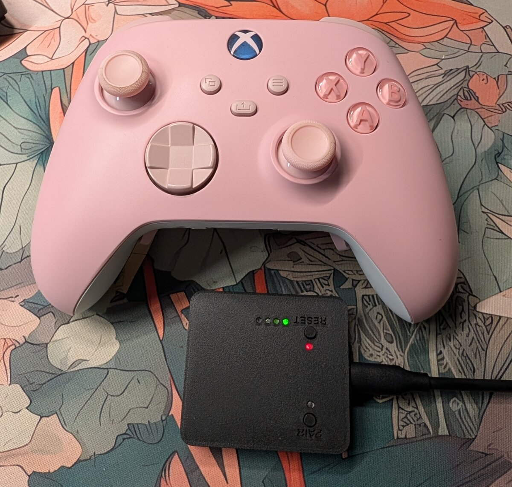

# XBX-NRF

A replacement bottom board for the **Xbox Series X|S controller (model 1914)**
built on a Nordic **nRF52840**. Uses a custom **2.4 GHz USB dongle** instead of 
Xbox Wireless / Bluetooth for improved connectivity. 

<p align="center">
  
</p>

> **Status:** Hardware Rev 1.1 up and running. Still in active development.
> Open tasks: [todo.md](todo.md).


## Who is this for

This is for those of us who love the Xbox controller's shape but hate how bad 
the Bluetooth connectivity is. This started as a labor of love for my partner 
who can't find a controller she likes besides the Xbox controller but also can't 
stand the disconnects.

That being said, there are some real concessions. The most obvious is that the 
controller won't work with an Xbox anymore. Another concession is that support 
for the rechargeable battery packs, as well as the expansion and headphone ports 
was dropped.

- How to build the hardware:
    [Building the hardware](docs/hardware_assembly.md)
- Once you have hardware in hand:
    **[Getting started](docs/getting_started.md)**

## Architecture

```
┌─────────── Controller ───────────┐          ┌──── Dongle ────┐
│ Stock top board ─J3─ new board   │ 2.4 GHz  │ nRF52840 + USB │
│ buttons (PCAL6416)  nRF52840     │◀────────▶│ XInput / HID   │──▶ PC
│ power latch, boost  radio,       │   ESB    │ gamepad        │
│ USB-C, 2×AA input   sticks,      │          │                │
│                     triggers,    │          │                │
│                     rumble       │          │                │
└──────────────────────────────────┘          └────────────────┘
```

## Features


| Area | Feature |
|---|---|
| Target | Xbox Series X\|S Controller (model 1914)|
| Scope | New bottom board, stock top board, shell, triggers, motors reused |
| MCU | nRF52840 |
| Wireless | Nordic ESB 2.4 GHz. The project does **NOT** use Bluetooth! |
| Multiplayer | Up to 7 paired, 4 connected per dongle |
| Polling rate| 1 kHz with 1–2 controllers, 500 Hz with 3–4 |
| Dongle USB mode| HID gamepad (**1 player**) and XInput (**4 players**) |
| Battery | **AAs only** - basic rechargeables are OK, but no Play & Charge |
| Rumble | reuses all the stock motors, including triggers |
| Buttons | reuses stock with additional options for 2 AUX trigger switches and 4 paddles |
| Waking PC | Works in wireless AND wired mode! |
| Audio | None in v1 |
| Expansion port | None in v1 |

> [!WARNING]
> **Never put a bare Li-ion cell on the AA contacts**: The boost converter
> appears to pass that straight through and the nRF52840 is only rated to 
> **3.6v** in this configuration!
> ([docs/hardware.md](docs/hardware.md)).

## Hardware

The custom board replaces the stock bottom board in the controller. It plugs 
into the stock top board's 14-pin **J3** connector. This provides power rails, 
USB, I2C to the button expander, and Guide / Pair / power-hold signals.

| Doc | Covers |
|---|---|
| [docs/hardware.md](docs/hardware.md) | Top board power, J3 pinout, antennas, dongle pin map |
| [docs/pcal6416.md](docs/pcal6416.md) | Button expander: button map, registers |
| [docs/a3910.md](docs/a3910.md) | Rumble drivers: wiring, logic table |
| [docs/teardown.md](docs/teardown.md) | Test controller teardown: motor wires |


## Firmware

Built using the nRF Connect SDK. Version is pinned at v3.4.1 to ensure future 
buildability (hopefully). The controller firmware has a target for the custom 
board and the dongle firmware has a target for the custom dongle as well as the 
PCA10059 dongle. You may notice there is a nice!nano/pro-micro target for the 
controller, but this is just for testing.


| Doc | Covers |
|---|---|
| [docs/controller.md](docs/controller.md) | Using it: power, pairing, LED, wired modes, calibration, waking the PC |
| [docs/building.md](docs/building.md) | Setup; building the firmware, bootloader and configurator; versions |
| [docs/flashing.md](docs/flashing.md) | Flashing and debugging |
| [docs/protocol.md](docs/protocol.md) | Radio (pairing, time slots) and USB (HID, XInput) protocols |
| [docs/gip.md](docs/gip.md) | Xbox GIP protocol notes (optional mode) |


## Configurator

Desktop app for settings, calibration, input and rumble tests and firmware
updates of both devices over USB using Python + Tkinter. So far only tested on 
Linux, but in theory should be buildable on Mac and Windows.

- Getting started:
  [docs/getting_started.md](docs/getting_started.md#setting-up-the-configurator)
- Details: [docs/configurator.md](docs/configurator.md)

## Repository layout

```
docs/                documentation
firmware/
  boards/            our board definitions (xbx_controller, xbx_dongle)
  bootloader/        UF2 bootloader build (upstream + our boards)
  common/            shared code (include/protocol.h)
  xbx-nrf/           controller app
  dongle/            dongle app
  ncs-version        pinned SDK + toolchain
  check-sdk.sh       version check for build.sh
  build.sh           build (+ flash) script
pcb/xbx-nrf/         KiCad project, controller board (lib/: symbols,
                     footprints, 3D)
pcb/xbx-nrf-dongle/  KiCad project, dongle board
mech/                FreeCAD parts: controller-bottom-board/ (board outline),
                     dongle-enclosure/, aux-button-guide/ (CC BY-NC-SA remix)
references/          schematics, scans, datasheets, pinouts
tools/               configurator/, release scripts (pcb-release.sh,
                     release-notices.sh), test-rumble.sh
todo.md              task list
```

## Disclosures

This was built with the help of Claude Code. PCB designs are completely hand 
designed by myself, and all code was either written or reviewed by 
myself. However, there are likely still bugs present as this is a hobbyist 
project in early development. PCB designs may also have flaws for the same 
reasons. If you find and bugs or issues with the hardware, please [open an 
issue](https://github.com/zuidec/xbx-nrf/issues) to let me know.

## References

- Schematics, scans, pinouts and datasheets:
  [references/README.md](references/README.md) (third-party, not in the repo;
  source links there)
- [AcidMods — XB1 controller PCB scans](https://acidmods.com/forum/index.php?topic=44547.120)
- [GP2040-CE](https://github.com/OpenStickCommunity/GP2040-CE) (XInput
  reference)

## License

Copyright (c) 2026 zuidec. Firmware and scripts: **MPL-2.0**. Hardware
design: **CERN-OHL-S-2.0**. Documentation: **CC-BY-4.0**. Third-party CAD
parts (SnapMagic, KiCad libraries) keep their CC-BY-SA-4.0 licenses; see the
`ATTRIBUTION.md` in each library folder. Details: [LICENSE](LICENSE),
[REUSE.toml](REUSE.toml), full texts in [LICENSES/](LICENSES/).
